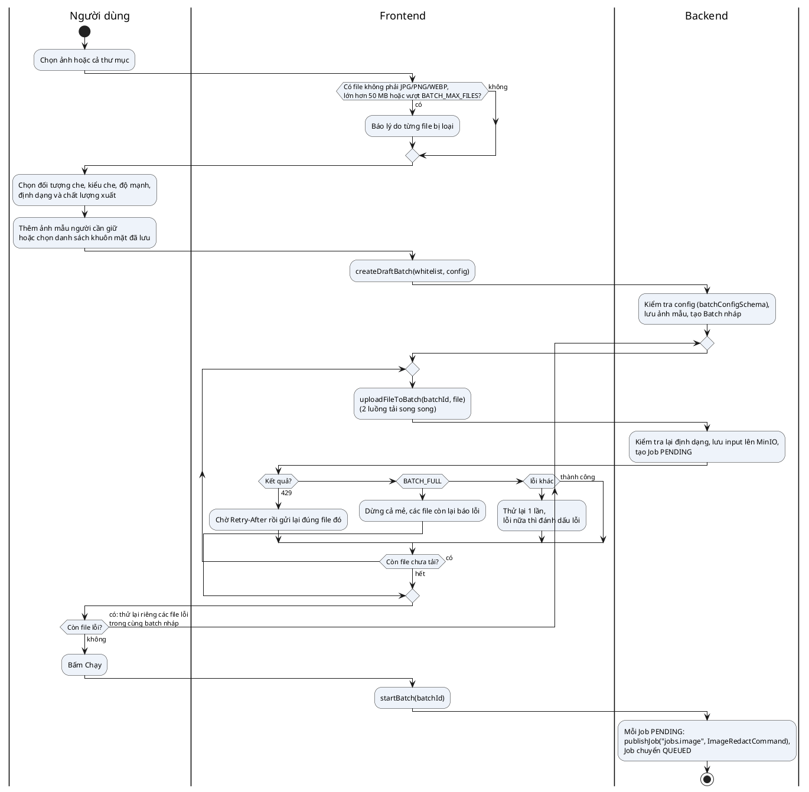

# Hình 3.4: Biểu đồ hoạt động ca sử dụng UC01 Tạo batch ảnh và tải lên

Viết bằng PlantUML (activity diagram, swimlane theo tác nhân). Nguồn: web/frontend/src/api.ts (uploadBatch, 2 luồng tải
song song, xử lý 429 và BATCH_FULL), web/backend/src/services/batch.service.ts, decisions.md (F.1).

