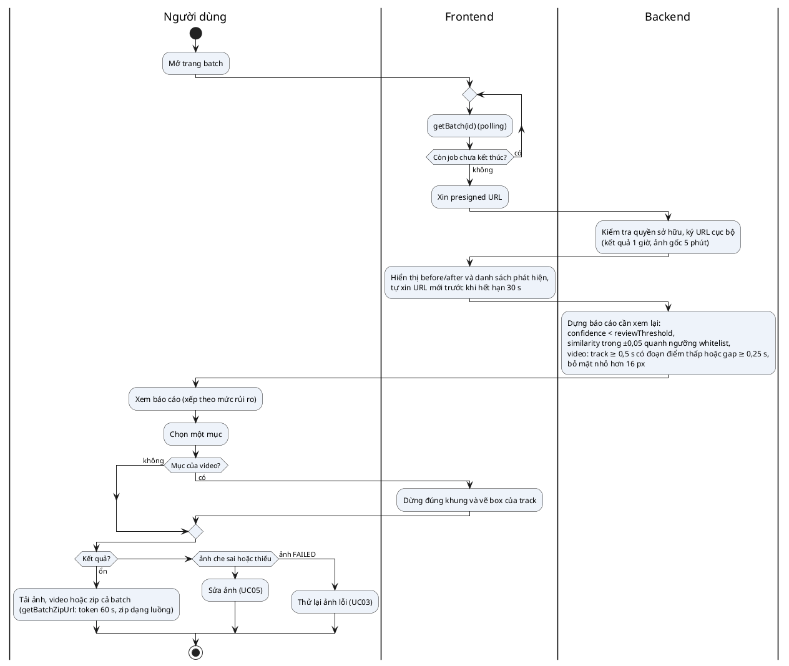

# Hình 3.7: Biểu đồ hoạt động ca sử dụng UC04 Xem kết quả và báo cáo cần xem lại

Viết bằng PlantUML (activity diagram, swimlane theo tác nhân). Nguồn: web/frontend/src/api.ts, sync.ts,
web/backend/src/services/presign.service.ts, decisions.md (D, F.2).

